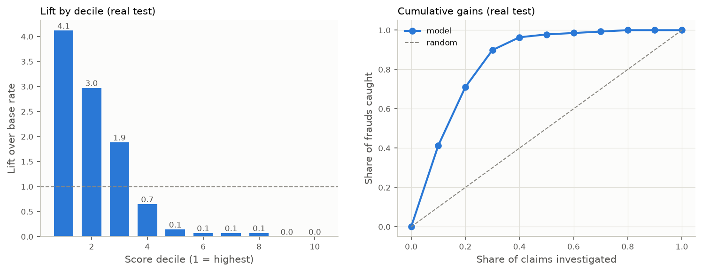
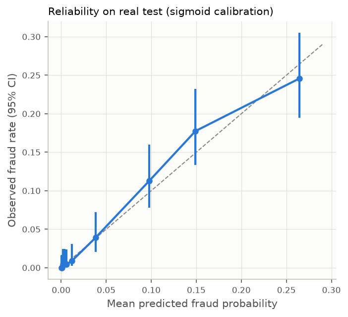
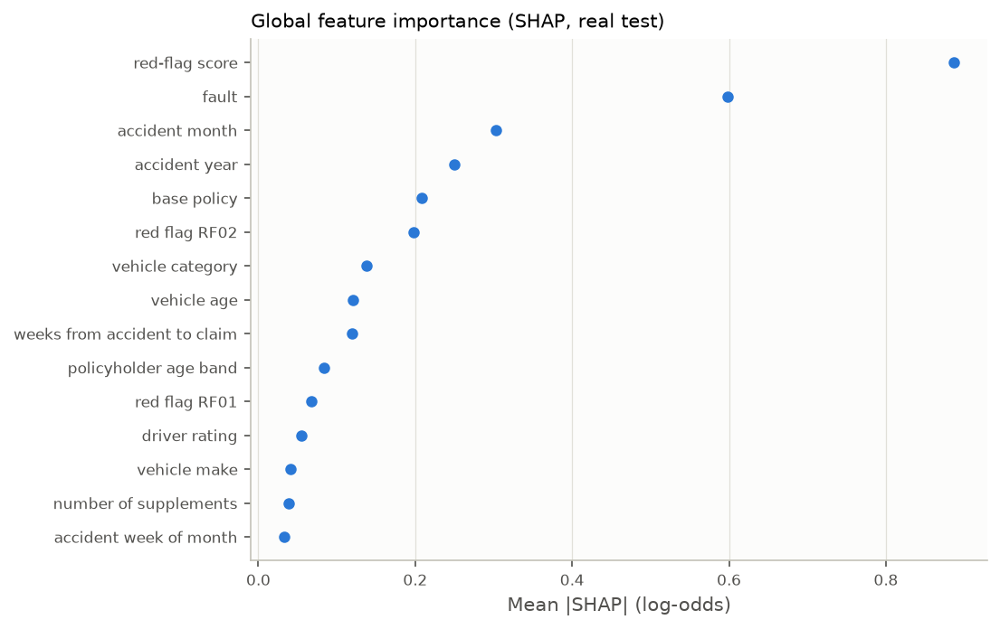
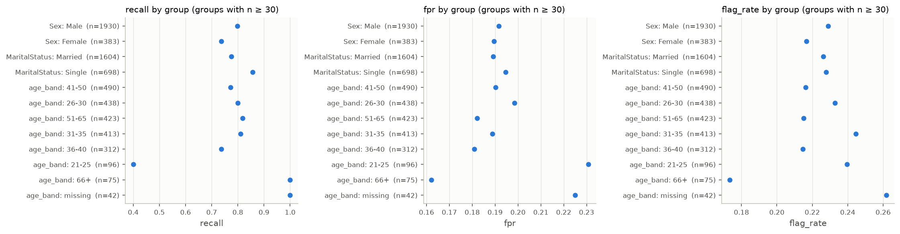

# Model Report: Fraud-Scoring Model (Step B)

_Final model: `lightgbm-b200-20261016-0915` (`models/`). Trained with
`notebooks/02_model_training.ipynb` on an NVIDIA B200. Report assets were regenerated from the
frozen artifacts with `scripts/regenerate_model_report.py` (`tables/02_*.csv`,
`figures/02_*.png`). The model card is `model_card.md`._

**Where the numbers come from:**

- **Artifacts:** metrics recomputed from the frozen artifacts. Recomputing the test metrics
  reproduces `model_card.json` exactly; the script stops otherwise.
- **Partial run:** some figures come from an **earlier, incomplete B200 run** whose files were
  pushed to `main` and are now in `docs/report/b200_partial_run/`. They are marked *(partial
  run)*.
- **Not available:** the final run's own `outputs/tables` (data mix, model zoo, tuning) were not
  uploaded. §8 lists what is needed.

## 1. Summary

- **Final model:** LightGBM with library-default hyperparameters, 3 seeds averaged, then Platt
  calibration.
- **Training data:** 10,793 real training claims plus all 289,207 synthetic claims at sample
  weight 0.1.
- **Held-out real test results** (2,313 claims, 138 frauds, evaluated once), at the 10:1 cost
  threshold:

  | Metric | Value | 95% CI |
  |---|---|---|
  | ROC-AUC | 0.874 | 0.852–0.895 |
  | PR-AUC (random scorer = 0.060) | 0.252 | 0.214–0.317 |
  | Recall | 0.790 | 0.717–0.855 |
  | Precision | 0.208 | 0.188–0.229 |
  | False-positive rate | 0.191 | |
  | Flag rate | 22.7% of claims | |

- **Synopsis success criterion: met.** "Precision and recall both meaningfully above the naive
  baseline":

  | | This model (lower CI) | Random flagger at the same flag rate |
  |---|---|---|
  | Precision | 0.188 | 0.060 |
  | Recall | 0.717 | 0.227 |

  The all-legit predictor has 94.0% accuracy but zero recall.
- **The model beats the rules-only red-flag score on every ranking metric:** test PR-AUC 0.252
  vs 0.139, ROC-AUC 0.874 vs 0.793. At a matched flag rate it is also better on precision
  (0.208 vs 0.158) and recall (0.790 vs 0.659).
- **The neural network (MLP) is being trained on CPU here (§5).** It is compared on real
  validation only.

## 2. Setup

| Item | Choice |
|---|---|
| Training data | real train + 100% synthetic; synthetic weight chosen by the data-mix experiment (§3); final w = 0.1 |
| Features | 89 columns from `src/ml/preprocess.py`: one-hot nominal, ordinal ranges, numerics, engineered flags, 12 red-flag indicators + red-flag score, consistency-failure count. `Sex`, `MaritalStatus`, raw `Age`, `RepNumber`, `PolicyType`, `AgeOfPolicyHolder`, `PolicyNumber` and `is_synthetic` are excluded (`01_eda_report.md` §5). |
| Model selection | real validation (2,313 claims, 139 frauds), PR-AUC as the primary metric, 95% stratified bootstrap CIs |
| Imbalance | `scale_pos_weight` (class weights) throughout; no resampling (96% of rows are already synthetic) |
| Final model | 3-seed ensemble (42/43/44), early stopping on real-validation PR-AUC |
| Calibration | 5-fold cross-fitted on real validation; Platt (Brier 0.0485) beat isotonic (0.0500); uncalibrated Brier 0.159 |
| Thresholds | chosen on out-of-fold calibrated validation scores; costs 5:1 / 10:1 / 20:1 + top-10% capacity |
| Test set | opened once, by the B200 run |

## 3. Baselines and the data-mix experiment *(partial run)*

These numbers are from the earlier run (`b200_partial_run/tables/*.csv`, XGBoost, 2 seeds,
real-validation PR-AUC). The final run repeated the experiment and chose w = 0.1. Its own table
was not uploaded.

| Training data | Train rows | PR-AUC (mean of 2 seeds) |
|---|---|---|
| Real only | 10,793 | 0.238 |
| Real + 10% synthetic | 39,714 | 0.237 |
| Real + 25% synthetic | 83,095 | 0.259 |
| Real + 50% synthetic | 155,397 | 0.270 |
| Real + 100% synthetic, w = 1.0 | 300,000 | 0.274 |
| **Real + 100% synthetic, w = 0.3** | 300,000 | **0.286** |
| Real + 100% synthetic, w = 0.1 | 300,000 | 0.284 |
| Synthetic only | 289,207 | 0.275 |

- **More synthetic data helps steadily, by about +0.04 to +0.05 PR-AUC over real-only.**
  Down-weighting it to 0.1–0.3 is slightly better than weight 1.0. The same pattern appeared
  in the EDA's LightGBM utility test (`01_eda_report.md` §2.4).
- **Weights 0.1 and 0.3 are indistinguishable.** The gap (0.002) is within the seed noise
  (SD 0.003–0.004), which is why the two runs chose differently.
- **Baselines** (same partial run, real validation):

  | Baseline | PR-AUC | ROC-AUC |
  |---|---|---|
  | All-legit | 0.060 | 0.50 |
  | Rules-only red-flag score | 0.142 | 0.781 |
  | Class-weighted logistic regression | 0.193 | 0.815 |

## 4. Model comparison and tuning

**Real-validation PR-AUC:**

| Model | PR-AUC | Source |
|---|---|---|
| **LightGBM**, defaults, 3 members (final model) | 0.294 / 0.289 / 0.290; ensemble **0.291** (calibrated: 0.291; out-of-fold calibrated: 0.286) | artifacts |
| XGBoost (w = 0.3) | 0.283 | partial run |
| Random Forest | 0.246 | partial run |
| Logistic regression | 0.193 | partial run |
| MLP (CPU, this PR) | see §5 | this PR |
| CatBoost | not available: not installed in the partial run; the final run's zoo table was not uploaded | — |

On validation, LightGBM and XGBoost are within noise of each other: about 0.29 vs 0.28, with
bootstrap CIs of roughly ±0.06.

**Tuning:**

- The final model uses **library-default parameters**: learning rate 0.03, 31 leaves,
  `min_child_samples` 50, subsample and colsample 0.8, λ = 1. Early stopping kept 488, 490
  and 381 trees.
- The uploaded `model_card.json` recorded `"params": {}`. That field held only the overrides
  on top of the defaults, so it was not a missing value but it was not informative either.
  An empty dict means either the Optuna result did not beat the defaults or the tuning section
  did not run. The tuning tables would show which (§8).
- **Fixed in this PR:**
  - The card now records the effective parameters (read from the pickled estimators), the
    overrides, the parameter source, the best iterations and the per-family tuning outcome.
  - The adoption rule now compares tuned vs default **mean over the same seeds**. The old code
    compared a 3-seed mean with a single default run.
  - The fix was verified on a FAST_MODE run.

## 5. MLP on CPU

The MLP was skipped on the B200 because of a torch/numpy mismatch. It was trained here on CPU:

- same data mix (real + 100% synthetic, w = 0.1), same 89 features (as integer codes for
  entity embeddings plus scaled numerics);
- early stopping on real-validation PR-AUC;
- 3 seeds with default architecture, then 8 Optuna trials, a 3-seed stability check on the top
  2, and a 3-seed refit.

Only real validation was used. Results: `tables/02_mlp_vs_lightgbm.csv`.

_In progress: the results are added when the CPU run finishes._

## 6. Final test evaluation (real test, evaluated once by the B200 run)

### 6.1 Metrics vs baselines

Baselines are flagged at the same flag rate as the model, so precision and recall are directly
comparable.

| Model | PR-AUC [95% CI] | ROC-AUC | Precision | Recall | F2 | FPR |
|---|---|---|---|---|---|---|
| **Final model (calibrated LightGBM)** | **0.252** [0.214, 0.317] | **0.874** | **0.208** | **0.790** | **0.506** | 0.191 |
| Rules-only (red-flag score) | 0.139 [0.124, 0.164] | 0.793 | 0.158 | 0.659 | 0.403 | 0.223 |
| All-legit | 0.060 | 0.500 | — | 0 | — | — |

**Confusion matrix at 0.108:** TP 109, FP 416, FN 29, TN 1,759.

**Other operating points on test:**

- Top-10% capacity threshold (0.189): flag rate 9.5%, precision 0.255, recall 0.406, FPR
  0.075.
- Precision in the top 5% of scores: 0.293.
- Validation-tuned thresholds held up on test (validation → test):

  | | Validation | Test |
  |---|---|---|
  | Recall | 0.791 | 0.790 |
  | Flag rate | 24.0% | 22.7% |

**Lift by decile:**

- The top decile has 4.1× the base fraud rate (24.6% fraud).
- The top 3 deciles (30% of claims) contain 90% of frauds.
- Deciles 5–10 contain 5 frauds in 1,387 claims.

### 6.2 Calibration

- Test Brier score is 0.0488, against 0.056 for always predicting the base rate.
- Mean predicted probability tracks the observed fraud rate in every score decile, within the
  95% CIs.
- The top decile predicts 0.264 and observes 0.246.

## 7. Explainability, errors and fairness

### 7.1 SHAP (TreeSHAP on the uncalibrated ensemble, real test)

Global importance: mean |SHAP| in log-odds, with one-hot levels summed per claim before the
absolute value.

| Rank | Feature | Mean \|SHAP\| | Rank | Feature | Mean \|SHAP\| |
|---|---|---|---|---|---|
| 1 | red-flag score | 0.887 | 7 | vehicle category | 0.138 |
| 2 | fault | 0.599 | 8 | vehicle age | 0.120 |
| 3 | accident month | 0.303 | 9 | weeks from accident to claim | 0.119 |
| 4 | accident year | 0.250 | 10 | age band | 0.084 |
| 5 | base policy | 0.208 | 11 | RF01 indicator | 0.068 |
| 6 | RF02 indicator | 0.198 | 12 | driver rating | 0.055 |

**Agreement with the EDA red flags:**

- **Where SHAP agrees with the EDA:**
  - The strongest EDA signals (fault, base policy, vehicle category) are top SHAP features,
    directly and through the red-flag score.
  - The red-flag score is built from the EDA's rules (RF01–RF13).
  - Address change and the 500 deductible, which are strong in the EDA (IV 0.10 and 0.08),
    rank low on their own. Their signal is carried by RF03, RF04 and RF05 inside the score.
  - The local explanations show this: the top true positives are third-party claims with
    RF04 (third party + 500 deductible) firing.
- **Where SHAP disagrees: accident month ranks 3rd.**
  - The EDA found Month weak (IV 0.064, χ² p = 1e-4).
  - Year's rank (4th) matches the real downward trend (6.6% → 5.1% fraud, 1994 → 1996).
  - Month's rank is more than its univariate signal explains. The model may be fitting
    month-level noise, or month interactions; the synthetic data weakened Month's own signal.
  - A Month-ablation on validation is a cheap follow-up. It is not done here, so as not to
    revisit the test set.

**Local examples:** `tables/02_shap_local_examples.csv` lists true positives, false positives
and false negatives with their top 5 factors.

- **False positives** largely share the RF04 cluster: third-party claims with a 500 deductible
  and red-flag scores of 5–7. This cluster is mostly fraud in training (54.5%) but not always.
- **False negatives** are low-scoring Collision and Liability claims with no red flags.

### 7.2 Error analysis (test, threshold 0.108)

| Segment | n | Frauds | Recall | FPR | Flag rate |
|---|---|---|---|---|---|
| BasePolicy = Liability | 793 | 5 | **0.00** | 0.000 | 0.0% |
| BasePolicy = Collision | 874 | 68 | 0.69 | 0.241 | 27.6% |
| BasePolicy = All Perils | 646 | 65 | 0.95 | **0.382** | 44.0% |
| VehicleCategory = Sport | 845 | 15 | 0.67 | 0.014 | 2.6% |
| VehiclePrice < 20k | 164 | 17 | 1.00 | 0.340 | 40.9% |
| age band 21–25 | 96 | 5 | 0.40 | 0.231 | 24.0% |

- **Missed fraud:**
  - The model never flags Liability-only claims. That is about a third of claims, at 0.6%
    fraud, so all 5 Liability frauds are missed.
  - 21 of the 29 missed frauds are Collision claims.
- **Over-flagging:** All Perils policies are flagged 44% of the time (FPR 0.38). This is the
  cost of catching 95% of All Perils fraud, and the agent's evidence gathering is meant to
  help adjusters triage these.

### 7.3 Fairness (test, threshold 0.108)

`Sex` and `MaritalStatus` are not model inputs.

| Group | n | Fraud rate | Flag rate | Recall | FPR |
|---|---|---|---|---|---|
| Male | 1,930 | 6.2% | 22.9% | 0.80 | 0.192 |
| Female | 383 | 5.0% | 21.7% | 0.74 (n frauds = 19) | 0.190 |
| Married | 1,604 | 6.4% | 22.6% | 0.78 | 0.189 |
| Single | 698 | 5.0% | 22.8% | 0.86 | 0.195 |
| Age 21–25 | 96 | 5.2% | 24.0% | 0.40 (n frauds = 5) | 0.231 |
| Age missing | 42 | 4.8% | 26.2% | 1.00 (n frauds = 2) | 0.225 |
| Age 16–20 | 24 | 20.8% | 45.8% | 1.00 (n frauds = 5) | 0.316 |

- **Sex and marital status:** flag rates and false-positive rates differ by under 1.5
  points. Recall differences rest on 19–35 frauds per group, so they are within noise.
- **Age:** the bands differ more, and the 21–25 and 16–20 bands have higher FPRs.
  - Part of this is intended: the EDA found genuinely higher fraud rates for the youngest
    and missing-age groups, and RF09 targets young at-fault holders.
  - These groups have 2–5 frauds each in test, so their recall figures are not reliable.
  - This should be monitored once adjuster feedback exists.

## 8. Files needed from the final B200 run

To complete §3–§4 with the final run's own numbers, upload these from that run's `outputs/`
folder:

- `run_log.txt` and `run_log.csv`: every model's validation score.
- `tables/data_mix.csv`: the w = 0.1 choice.
- `tables/model_comparison.csv`: RF, XGBoost, LightGBM and CatBoost.
- `tables/tuning_summary.csv`, `tables/tuning_<family>_top_trials.csv`, and optionally
  `optuna.db`: why the tuned parameters were not adopted.
- `figures/data_mix.png`, `figures/model_comparison.png`.

Everything else in this report was regenerated from `models/`.
